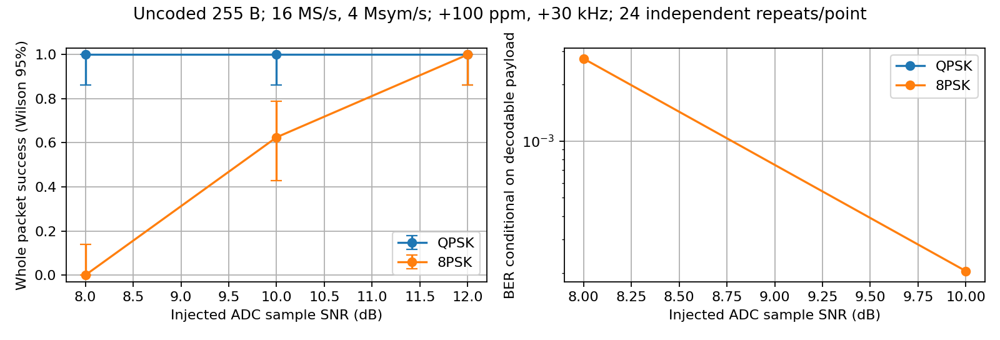
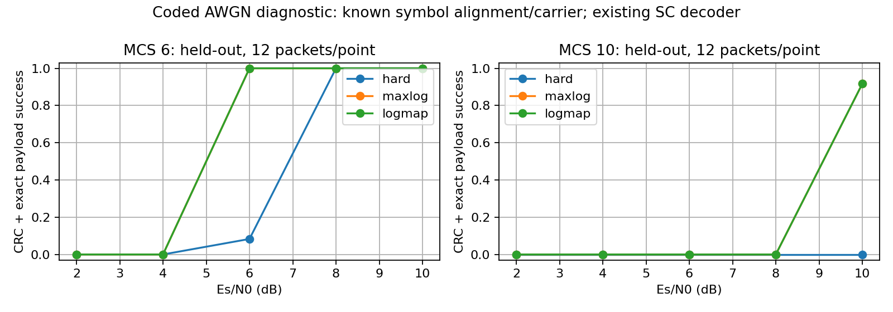
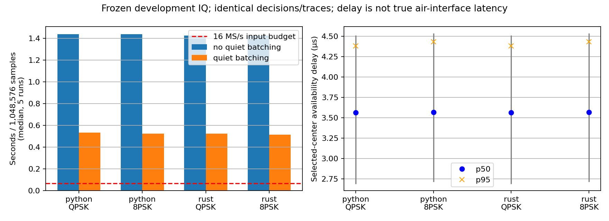

# 接收链修复分阶段记录

最终目标：让原始 IQ 经可审查的接收链到达 MAC，校验语义真实、流式状态有界、
软信息和性能收益可复现。失败保留为证据，不预设全通过。

| 阶段 | 子任务及完成标准 | 状态 |
|---|---|---|
| 1 | 真实 A/B 头 CRC、上下文、截断/非法长度、失败停止交付；基线复现及全量回归 | 实现并验证 |
| 2 | 捕获/同步/跟踪/严格帧解析接入 MAC；普通与 WS63 profile 分离，未知起点和长度反例 | 完成PSK FT2/3/4；FT1另有前端，未纳入新流式入口 |
| 3 | 有界增量滤波/插值/定时/帧状态；任意分块、多包、结束截断与整段轨迹对照 | 完整冻结364输入复核，无退化/分块差异 |
| 4 | 按实际星座/旋转/导频生成可靠度 LLR；编码开发/保留集与 Polar 对照 | 完成；保留低SNR编码失败 |
| 5 | 真实路径 profile、吞吐/延迟/内存；独立记录 Python/Rust，并验证优化等价性 | 静默批处理优化完成；双后端5次实测，未达16MS/s |
| 6 | CI 触发、依赖跳过、加速一致性；剩余低 SNR 的真值诊断及独立重复样本 | CI及独立边界复核完成；保留全部失败 |

每阶段更新本文及 CHANGELOG，运行针对性反例、ruff、全量测试，再单独提交推送。
只涉及离线模型、测试、文档和 CI；不操作设备、固件、RTL 或 Release。

## 阶段 1：控制 CRC 语义（§6.4）

基线 `e2f7b54` 的 `decode_head()` 对合法头、坏头和错误种子均返回 True。
使用同一个有导频、无编码的合法 8 字节载荷时，坏头和错误种子也会交付完整载荷。
现改为 A 组 CRC12（默认实际同步序列低 12 位，允许显式上下文种子），
B 组 CRC24B（固定 0x555555，异或显式 24 位 LLID）。数据 CRC 种子独立。
B 组缺失 LLID 抛出 ValueError；没有“未校验但成功”的状态。

| 固定种子 63016，数据导频 8 | 基线头/数据 CRC | 修复头/数据 CRC | 修复交付 |
|---|---|---|---|
| 合法头 | True / True | True / True | 64 bit |
| 头信息位损坏，重新 Polar 编码 | True / True | False / False | 空 |
| 用错误头 CRC 种子生成 | True / True | False / False | 空 |

头码长必须准确，短头和多余头位均拒绝；非二进制输入和非法配置报错。
`rx_chain(iq,cfg,n_data_bytes)` 仍是已知配置、理想对齐接口，长度必须为 [0,2047] 整数。
先只解头；坏头不进行载荷解映射、码块分割或译码。成功后才按已知长度处理载荷；
载荷截断或数据 CRC 失败不交付。CRC 失败但可计算的译码比特只在
`diagnostic_data_bits` 中保留，不能当成 MAC 数据。
两种 pipeline 仿真的 BER 按可译码比特统计，另报 erasure_rate；没有可比较比特则为 NaN。

A2 正例此前漏传可选 LQI，发送 32 位却按 40 位译码；现在配置 28 个信息位时生成
8 位 LQI＋20 位 A2。B1 MAC 配置要求 27 信息位及显式 head_llid。
随机“信息＋随机 CRC”的 FT3/4 正例改为随机信息附加真实 CRC，原无效输入另有拒收测试；
期待载荷和标准向量不变。USRPLoopbackSim 默认头也附加真实 CRC。
节点接收使用已知对端地址对应的模型 PID；显式 `receive(...,rx_config=...)` 可用于自身理想环回，
不尝试不同种子或以 CRC 选择上下文。

另一个已有缺陷被保留：数据无导频时，旧理想解析器错误消耗最后一个控制导频，
本次固定输入的合法载荷仍失败，旧接口现拒收，不能记作 CRC 语义修复后的成功。
阶段 2 将统一字段边界，禁止用放宽断言掩盖该问题。

## 阶段 2a：统一 PSK 字段符号位置（§6.2.1.2、§6.7）

独立角度公式参考在 `db0996a` 上的 8 个 QPSK/8PSK、导频 0/4/8/16 对照全部失败。
原 TX 将符号交替相位在字段边界重置，并在压缩的数据索引上旋转后插入导频；
原 RX 用相同错误抵消了回环问题。现在发送与解析都按包含导频的帧内实际位置计数，
共用 `psk_fields`；不改期待星座和载荷。8PSK 尾部不足 3 bit 的补位不计入载荷。

数据无导频时，末尾控制导频实际省略，现在解析器同步省略该位置；
阶段 1 中保留的合法无导频样本恢复。该修改改变旧模型错误的 PSK 波形，
旧模型生成的 IQ 不是新的标准映射正例；原真实厂测获取使用帧内索引，保持不变。
旧内部映射工具仅供基础映射测试，主 TX/RX 不再使用字段重置路径。

复现：`uv run --frozen --no-sync pytest tests/test_psk_field_layout.py -q`。
基线日志 `rx-field-baseline.log/xml` 保留 8 个失败，无载荷/CRC 驱动的相位重试。

## 阶段 2b：严格接收主入口与 MAC 集成

`receive_capture` 复用既有能量分段、差分同步、CFO/增益估计、分数搜索及 Gardner/PI 跟踪，
`PSKReceiveProfile` 明确 A2/A3/B1 格式和链路上下文，`decode_psk_frame` 先校验头后读取长度及 MCS，
`iq_to_mac_capture` 仅向 MAC 交付完整 CRC 正确包。普通与 WS63 profile 分离，
旧厂测解析兼容入口复用同一核心。使用方式见[严格接收教程](../how-to/strict-receive.md)。

独立连续时间脉冲与角度参考固定 payload seed65016、quiet seed65017、偏移 .277 sample，
正输入覆盖 FT2 MCS6/8/12、FT3 MCS8、FT4 MCS0、导频0/4/8，分别 CFO0/SRO0 和 CFO30kHz/SRO100ppm。
这 10 个输入在旧理想接口因未知起点全部拒收，在新 MAC 路径 10/10 内容、长度及 CRC 正确。
坏头、坏数据和 empty/length 矛盾的 3 个负输入均不交付；新增单测还包括错误种子、
截断头/数据、长度上限、未知 MCS、静默、坏头后下一包和分离能量段多包。
全量测试 2891 通过、2 跳过，覆盖率91%。

对冻结的 364 个输入，经公共 MAC 入口复核：

| 输入 | 数量 | 正确 MAC 整包 | 与原相干接收成功位置不一致 |
|---|---:|---:|---:|
| 旧仿真＋新增噪声 | 206 | 201（旧190/190，新增11/16） | 0 |
| 真实 IQ | 6 | 63，另有1个尾部截断 | 0 |
| 原有 SRO 派生 IQ | 8 | 84 | 0 |
| r2 静默 | 144 | 0（无同步候选） | 0 |

新增 5 个低 SNR 失败未改变：new-noise-00/01/04/08/12；01 仍是单比特载荷错误、CRC 失败。
`parser-replay/failures.json` 与符号/BER证据、`mac-replay-final/failures.json` 的公共入口结果互相关联。
真实 IQ 的原始时钟偏差未知；附加±100ppm只称注入量，不报告绝对真定时误差或收敛时间。
144份静默无候选是本次输入结果，不是已证明的普遍误检率。

重放只读取冻结元数据、原始 SHA-256、已存派生文件及其哈希，禁止用共享新索引替换输入。
`mac-replay-final` 保存逐输入源码/输入身份、帧状态、成功同步位置、MAC交付数、耗时和原诊断链接。
初步单次时间混合 IO/进程负载，不用来宣称优化或实时能力；正式性能分析在后续阶段。
这是纯 Python 环境，Rust对照尚未完成。

公共入口复核命令（每次使用新输出目录）：

```sh
B=/home/sanchuanhehe/.codex/visualizations/2026/11/15/01a1dfe8-f1ae-7233-a63e-c31ffad2d428
PYTHONPATH=src UV_CACHE_DIR=/tmp/rx-uv uv run --frozen --no-sync python \
  scripts/rx_mac_frozen_replay.py \
  --replay "$B/rx-chain-hardening/parser-replay" \
  --original "$B/rx-timing-tracking/final" \
  --dataset /home/sanchuanhehe/Documents/opensparklink/sparklink-hw/datasets/sle-rf/ws63/20261115-rx2 \
  --quiet-dataset /home/sanchuanhehe/Documents/opensparklink/sparklink-hw/build/evidence/20261116-ws63-release-r2/ws63-rx2-20261115-r2 \
  --output /tmp/mac-replay-new
```

当前 CI 仅 master push / master PR 触发，特性分支直接推送尚未触发 CI；
本阶段只报告已执行的本地 lint/测试与远端提交核验，触发修正在 CI 阶段完成。

## 阶段 3a：有界流式开发闭环

`af9f126` 上，同一能量段的两个连续独立参考包只收到一个；原始输入、两个真值同步位置、
哈希和预定义容差保存在 `streaming-baseline-input.npz` / `streaming-baseline.json`。
新 `PSKStreamReceiver` / `MacStreamReceiver` 在 EOF 前收到两个完整包。
逐包定时/载波状态重置、连续 FIR 状态保留，不用 CRC 选择下一同步或重试参数。

已测试固定1/7/31/32/37/511采样块和随机分块；整块/分块的包判定与轨迹满足事先固定容差。
覆盖头/数据跨块、坏头后连续好包、EOF头/数据截断、长静默、非法配置和输入结束后误用。
FT2/3/4 编码样本与离线路径比较；最大2047字节A3、±100ppm、30kHz CFO 的完整内容及独立定时真值也验证。
迭代接口在消耗完整大输入之前便产生第一个包，避免仅在 EOF 后批量处理。
全量2905通过、2跳过，覆盖率91%；ruff通过。

差分已知同步搜索和 Gardner/PI 状态被抽为共享组件，旧整段方法保留 CubicSpline，
流式用局部四点插值。重构后开发真实 IQ 的30个中心/速率/TED数组与旧冻结记录逐位一致。
共享组件的364输入整段回放仍无成功位置退化（`shared-sync-pi-replay`）；
这不代表所有这些输入的流式路径已经复核。

开发真实 IQ `series-02/mode-057/rx-00` 按原哈希读取，流式和整段均正确接收10个完整包。
原型未加 profiler 的流式耗时1.435s、约0.731MS/s；整段0.179s，目标16MS/s未达到。
初始化0.035s单列。状态NumPy数组约452776字节；原型历史/滤波状态495元素，能量历史另存，
进程RSS高水位约219MiB包含调用者IQ、校准、诊断及profiler，不能写成接收器只用0.45MB。
这些是单次开发观察，还不是延迟分布或可信的性能提升比例。

cProfile 3.358s中短块lfilter累计约1.984s，65540次调用；短块数组准备/拼接和重复搜索亦可见。
先保存原型及源码快照，再据此优化，不能仅凭循环数判断热点。
`stream-initial-profile` 保存原始输入/校准哈希、全部帧、轨迹、.pstats、热点表、精确原型源码快照。
原型快照早于逐事件迭代接口，哈希已逐文件验证；正式结果应以对应快照重放。
一次原型驱动将十六进制JSON种子误传为字符串，接收器拒绝配置；该错误记录保留，
修正驱动的显式数值解析后才执行算法，不更改接收规则。

```sh
PYTHONPATH=src UV_CACHE_DIR=/tmp/rx-uv uv run --frozen --no-sync python \
  scripts/profile_rx_stream.py \
  --original "$B/rx-timing-tracking/final" \
  --dataset /home/sanchuanhehe/Documents/opensparklink/sparklink-hw/datasets/sle-rf/ws63/20261115-rx2 \
  --sample-id series-02/mode-057/rx-00 --output /tmp/stream-profile-new
```

$B沿用前述证据根目录。纯Python，Rust未安装；未改变原低SNR保留集，也尚未给出流式的全量误检/漏检结论。

## 阶段 3b：经 profile 定位的静默滤波开销优化

不改变能量门限或同步/CRC决策，仅对能量确认低于原门限的已提供输入分块加速。
每128个内部量子做有限大小的能量检查；若可能包含信号则照常逐量子处理。
静默快路径从零状态重放超过 FIR/能量有限记忆的尾部，恢复相同量子边界的历史，
不等待额外输入，不引入4096样本的接收等待（SPS4时批大小4096）。
额外临时数组有固定上限；可用 `quiet_batching=False` 明确复现未优化算法。

在同一进程、相同冻结开发 IQ、交替方法顺序、一次暖机后各3次测量：

| 开发输入 | 原中位耗时/s | 优化中位耗时/s | 吞吐/MS/s | 观察到的倍数 |
|---|---:|---:|---:|---:|
| QPSK mode-057/rx-00 | 1.486 | .558 | 1.878 | 2.66 |
| 8PSK mode-065/rx-00 | 1.488 | .553 | 1.895 | 2.69 |

每份1048576样本；初始化分列，不计入此吞吐。两方法所有完整包、CRC、输出时点和轨迹一致。
新测试对长静默夹连续包、1/37/4095/4096/8192及随机分块比较；
最终FIR历史/状态逐位相同，轨迹满足先前冻结容差。
2906通过、2跳过、覆盖率91%，ruff通过。
这是纯Python、一次大输入调用的开发对照，小调用可能无法使用批处理；
未达到16MS/s，不外推为Rust、实时FPGA或完整接收机能力。
RSS为两方法、调用者输入和校准共用进程高水位，不能用来宣称单方法峰值内存下降。

`quiet-batching-benchmark` 保存冻结输入/源码、逐次时间与延迟分位数、基线轨迹和图表
`quiet-batching-cost.png/svg`；红虚线为16MS/s输入时间预算，两方法均高于该预算。
延迟仅相对接收器最后一个所选符号中心，不是真实空口时间真值。

```sh
PYTHONPATH=src UV_CACHE_DIR=/tmp/rx-uv uv run --frozen --no-sync python \
  scripts/benchmark_rx_stream.py --original "$B/rx-timing-tracking/final" \
  --dataset /home/sanchuanhehe/Documents/opensparklink/sparklink-hw/datasets/sle-rf/ws63/20261115-rx2 \
  --sample-id series-02/mode-057/rx-00 --sample-id series-02/mode-065/rx-00 \
  --repeats 3 --output /tmp/quiet-benchmark-new
```

## 阶段 3c：跨包译码器缓存上限

单帧状态数组不含全局 Polar 译码器池。基线 `48764e4` 在 FT2、CRC24、
1..2047字节、所有已建模码率的合法几何扫描中保留77个译码器，NumPy工作区约1.35MB，
旧缓存没有淘汰策略。该观察不称为严重内存泄漏，也不能用单帧数组大小替代进程内存。

现将 `get_polar_decoder(N,K)` 的资源策略明确为最近64个实例；最近复用不变，淘汰后按相同参数重建。
容量是实现资源上限，不是标准合格限值。译码器含可变工作区，当前查找实例须串行使用。
合法几何扫描验证上限、最近项保留及淘汰后输出不变；记录 `decoder-cache-baseline.json`。
完整2907通过、2跳过，覆盖率91%，ruff通过。

## 阶段 3d：保留并修复流式同步准备边界退化

首次364输入流式冻结结果在 `stream-frozen`，源码基线 `d29d447`：
仿真203/206（新增两个8dB QPSK恢复），真实63包、派生83包、144份静默无候选；
整段/4096块及选定随机分块无任何判定或轨迹不一致。
但 `series-02-mode-065-rx-02-injected100` 有一个原成功包退化，不能算该阶段全通过。
完整失败、恢复、退化、逐块轨迹与来源/哈希均保留，不覆盖此目录。

固定原轨迹和原载波参数的诊断表：

| 轨迹 | 局部4点插值 | 整段CubicSpline |
|---|---|---|
| 旧流式轨迹 | CRC失败，载荷6位错 | CRC失败，同样6位错 |
| 原整段轨迹 | CRC正确，0位错 | CRC正确，0位错 |

因而没有通过更换插值器或调整环参数迎合该包。
原同步搜索先按等待保护区筛除较晚候选，再选最大值：在该时刻真正已观测最大峰为
419404.125、相关0.998796，却被替换成419403.0、相关0.856341（恰好超过0.85门限）。
错误相位提前1.125采样，后续定时积分51次触及限幅，载荷前段6位错误。
这些是真实输入上两接收器的采样差异，不是已知的绝对硬件定时误差；
原始SRO未知，+100ppm只是独立派生的附加注入量。

现在先按已观测的完整同步选最大峰，只有该峰满足准备条件才接受；否则等待下一处理量子。
不再为满足等待条件换成更弱的较早峰。不改变0.85门限、相位网格、插值器、Gardner/PI或CRC策略。
独立连续时间发送参考的新反例先失败后修复，并覆盖8种内部量子对齐位置。
目标派生文件恢复11个完整包；全量2916通过、2跳过、覆盖率91%，ruff通过。
修复后 `stream-fixed-final` 再次完整复核364份输入：仿真203/206、真实63个完整包及1个尾部截断、派生84包、静默144份无候选；无成功退化、无整段/分块判定或轨迹不一致。原83包结果仍作为基线保留。

可复现诊断与图表保存在 `guard-diagnosis-final`（含逐位错误位置、固定载波/轨迹对照、
同步相关曲线、轨迹差异及manifest），驱动为 `scripts/diagnose_stream_guard.py`。
对照图明确相对原接收器选点，不将判决残差或两接收器差值冒充真值。

```sh
PYTHONPATH=src UV_CACHE_DIR=/tmp/rx-uv MPLCONFIGDIR=/tmp/rx-mpl uv run --frozen --no-sync python \
  scripts/diagnose_stream_guard.py --stream-baseline "$B/rx-chain-hardening/stream-frozen" \
  --reference "$B/rx-chain-hardening/parser-replay" --original "$B/rx-timing-tracking/final" \
  --dataset /home/sanchuanhehe/Documents/opensparklink/sparklink-hw/datasets/sle-rf/ws63/20261115-rx2 \
  --sample-id series-02-mode-065-rx-02-injected100 --output /tmp/guard-diagnosis-new
```

## 复现与证据

```sh
PYTHONPATH=src UV_CACHE_DIR=/tmp/rx-uv uv run --frozen --no-sync python \
  scripts/rx_chain_crc_audit.py --output /tmp/header-after.json
UV_CACHE_DIR=/tmp/rx-uv uv run --frozen --no-sync pytest \
  tests/test_head_crc_semantics.py tests/test_rx_pipeline.py tests/test_ft_pipeline.py -q
```

相同 audit 可用 `git archive e2f7b54` 的源码作为 PYTHONPATH 回放基线；脚本无期待载荷驱动的选择。
Python 3.14.8，NumPy 2.4.3，SciPy 1.17.1，纯 Python Polar，无 Rust 扩展。
冻结种子、逐输入 IQ 哈希、四个接收源文件哈希、before/after JSON、基线 NPZ、全量测试报告保存在
本轮交付目录 `rx-chain-hardening`。本地证据根目录：
`/home/sanchuanhehe/.codex/visualizations/2026/11/15/01a1dfe8-f1ae-7233-a63e-c31ffad2d428/`。

此前低 SNR 边界以 `psk-noise-recovery-results.json` 为准：原 9 个恢复，新增 5 个仍失败。
不能用更换共享数据集的索引来复写冻结输入。


## 阶段 6a：测试含义与实际后端

此前工作分支没有 push 触发条件，`6918108` 的 GitHub 精确提交查询返回空运行列表。
现在 CI 明确接收 `master`、`codex/psk-timing-tracking` 推送，以及手动触发；PR 目标仍为 master。
推送状态与检查状态分别记录，不将推送成功当成 CI 已运行或通过。

原 HMAC-SM3 测试吞掉 `NotImplementedError`，没有执行算法也显示通过。
现在缺少 gmssl 时显式 skip；安装时核验三个独立 OpenSSL HMAC-SM3 向量（包括超过64字节的密钥），
并执行 SM3 配对结果断言。依赖存在但导入/实现损坏时失败，不以异常捕获改为成功。
新增 `sm3` 可选依赖固定 gmssl 3.2.2，独立 CI 作业预检必须可用。

Python/Rust 两个完整测试作业都先输出实际加载后端、Python、依赖版本及提交号。
Rust 作业必须构建成功且模块实际加载；扩展缺失不被算成 Rust 验证。
安装脚本 `--required` 构建失败返回非零并保留完整输出；maturin 1.16.0 纳入锁文件。
有扩展时直接运行 Python 与 Rust 的八种 Polar 几何、变可靠度 LLR、零 LLR 及四种带种子 CRC 对照；
无扩展时这组测试明确跳过。CI 的 JUnit、完整日志、构建日志、后端元数据在失败时也上传。
覆盖率作业强制纯 Python，门限90.1%，仍须关键反例和端到端测试。

本地独立 Rust 环境位于 `/tmp/rx-rust-env`，未改动主检出的共享环境。
依赖与构建输出、实际后端和测试报告保存在 `rx-chain-hardening/ci-verification`。
纯 Python 全量2918通过、6跳过，覆盖率90.65%；跳过包括未安装的可选依赖/扩展，不能称作已验证算法。
独立 Rust+SM3 环境全量2935通过、无跳过（17.49秒），包括所有后端一致性与可选 SM3 算法。远端结果另存。
严格文档构建还揭示此前新增模块/报告未进入目录及中文片段链接无锚点；补齐目录与显式锚点，保留原13条警告日志。

```sh
uv sync --frozen --group accel
uv run --frozen --no-sync maturin develop --manifest-path rust/Cargo.toml --locked --release
uv run --frozen --no-sync python scripts/check_receiver_backend.py --expected-rust yes --output backend.json
uv run --frozen --no-sync pytest tests/ -q --tb=short --junitxml=report.xml
# 独立无Rust环境执行可选SM3算法
uv sync --frozen --extra sm3
uv run --frozen --no-sync python scripts/check_receiver_backend.py --expected-rust no --require-sm3 --output backend.json
uv run --frozen --no-sync pytest tests/test_crypto.py tests/conformance/test_security.py -q
```

常规 `uv sync` 会调整环境依赖；开发者应在独立环境分别运行上述后端，不能用同一个标签混合两类性能结果。


## 阶段 4：编码软信息

基线 `1b015fa` 源码快照在 `soft-baseline`：所有编码符号先硬判决，再转换成固定±10 LLR。
新严格路径在载波细化后计算真实星座 LLR，保留可靠度、正确软解扰和码块切分；
理想 API 硬判决兼容路径保留。独立角度与逐标签高斯似然验证 BPSK/QPSK/8PSK、
绝对索引0/1/65、两种似然和导频；测试 FT2/3/4 跨码块、非零加扰、原始IQ及分块轨迹。

冻结 AWGN 诊断240包：开发/保留各120，种子71016/72016，MCS6/10，255字节随机内容，
Es/N0=2/4/6/8/10dB，每点12包，导频8，数据起点索引65，码块几何逐输入保存。
使用独立解析角度发送和复数高斯噪声，已知符号边界/载波/增益以隔离软信息；
不能把此结果算成实际捕获通过率。每个硬判决输出与冻结旧 `decode_payload` 逐位一致。
编码、头部格式和期待答案没有随结果调整；没有为未编码实验增加编码。

| 保留集，12包/点 | dB | 硬判决正确 | max-log正确 | log-MAP正确 |
|---|---:|---:|---:|---:|
| QPSK MCS6 | 2 / 4 | 0 / 0 | 0 / 0 | 0 / 0 |
| QPSK MCS6 | 6 | 1 | 12 | 12 |
| QPSK MCS6 | 8 / 10 | 12 / 12 | 12 / 12 | 12 / 12 |
| 8PSK MCS10 | 2 / 4 / 6 / 8 | 0 / 0 / 0 / 0 | 0 / 0 / 0 / 0 | 0 / 0 / 0 / 0 |
| 8PSK MCS10 | 10 | 0 | 11 | 11 |

保留集总计25/120→47/120；开发+保留共44包恢复、无原成功包退化，仍有大量低 SNR 失败。
log-MAP 与 max-log 在86个输入的错误位数不同，但完整包数相同，不能宣称更复杂算法必然更好。
两者进入已有 Python/Rust SSC SC，同一冻结集240输入的判定、译码比特和LLR逐项完全一致；本阶段没有引入 SCL。
Rust串行相同范围耗时为0.029s/0.062s/0.183s，表明译码已加速后log-MAP开销更明显，仍保留max-log默认。
纯Python串行预热、循环方法顺序的240包解映射LLR+译码总耗时：硬判决1.290s、max-log1.326s、log-MAP1.449s。
不含共同硬解映射、输入加载及接收捕获；不是原始IQ吞吐。每点仅12包，统计不确定度较大。

`soft-awgn-python` 保存首次冻结输入，`soft-awgn-python-serial` 保存正式串行成本及旧函数等价检查，
`soft-awgn-rust-serial` 对同一哈希输入验证加速实现；所有失败和每臂译码/LLR在各目录 evidence。
首次串行驱动动态导入缺少sys.modules注册的工具错误保留在 `soft-awgn-python-final`，不计作算法结果。
图 `coded-awgn.png/svg` 明确标注已知对齐的编码诊断。
完整2958通过、6跳过，覆盖率90.65%；独立Rust+SM3完整2975通过，ruff通过。

```sh
PYTHONPATH=src UV_CACHE_DIR=/tmp/rx-uv MPLCONFIGDIR=/tmp/rx-mpl uv run --frozen --no-sync python \
  scripts/audit_psk_soft.py --output /tmp/coded-awgn-new
# 第二环境通过 --inputs 重用第一目录的冻结NPZ，不能重新抽样后混作后端对照
PYTHONPATH=src /tmp/rx-rust-env/bin/python scripts/audit_psk_soft.py \
  --inputs /tmp/coded-awgn-new --output /tmp/coded-awgn-rust
```

CI提交 `1b015fa` 的 [push运行](https://github.com/OpenSparklink/sparklink_sim/actions/runs/43759734783)
9个作业全部成功；精确SHA、作业状态与本地报告在 `ci-verification`。
后续提交仍需分别核验，不能沿用此成功标记。


## 最终整段、分块与后端复核

算法源码冻结在 `a2ad44d`。Python 与 Rust 分别完整回放364输入，
逐包判定、输出样本时点及全部符号/中心/PI速率/TED数组完全相同；
还与软信息接入前 `stream-fixed-final` 的未编码结果逐项完全相同。
不是只比较“通过数量”。原静默144份均无候选帧；未知硬件绝对定时/SRO仍没有真值。
整段输入是同一有界流式状态机的单次feed，另与旧离线捕获核心分列比较。
旧离线核心每能量段只取一个同步，连续两个包曾漏一个；新流式测试在EOF前输出两个。
理想已知配置API仍保留，未知起点的独立10个IQ正例中旧理想入口0/10、新严格入口10/10。

| 冻结集合 | 原离线严格捕获 | 最终流式Python | 最终流式Rust |
|---|---:|---:|---:|
| 原仿真190输入 | 190正确 | 190正确 | 190正确 |
| 新噪声保留16输入 | 11正确 | 13正确 | 13正确 |
| 原始真实6输入 | 63完整正确＋1尾部截断 | 同左 | 同左 |
| 独立派生8输入 | 84正确 | 84正确 | 84正确 |
| 独立真实静默144输入 | 0候选 | 0候选 | 0候选 |

流式首次冻结发生过1个派生成功样本退化，已保留 `stream-frozen` 失败并在 `6918108` 修复；
最终回放没有成功退化和整段/分块差异。两个新增恢复均为QPSK `new-noise-04/12`，
不能据此称8PSK低SNR边界全部解决。分块对照前定义符号1e-12、中心1e-10采样、
速率1e-8ppm；固定4096覆盖全部输入，额外随机覆盖全部真实/派生、新噪声及选定长度，
单元测试还覆盖1/7/31/32/37/511等分块及任意内部量子对齐。

所有输入哈希、源码哈希和逐帧结果在 `final-stream-python/rust`；
跨后端逐数组验证在 `final-report-v2/cross-checks.json`，全部阶段失败索引在 `evidence-index.json`。
可移植机器结果副本：[rx-chain-hardening-results.json](rx-chain-hardening-results.json)。

## 阶段 7：剩余未编码失败及独立重复样本

### 三个冻结失败的诊断

| 输入 | 注入ADC样本SNR | 实际接收载荷错位数 | 真值定时＋盲载波 | 实际定时＋真值载波 | 真值定时＋真值载波 |
|---|---:|---:|---:|---:|---:|
| new-noise-00，8PSK | 8dB | 4 | 4 | 4 | 4 |
| new-noise-01，8PSK | 10dB | 1 | 1 | 1 | 1 |
| new-noise-08，8PSK | 8dB | 2 | 2 | 2 | 2 |

真值仅用于后验诊断；实际算法、通过率和相位选择均不读取真值。
注入载波为+30kHz，SRO为+100ppm；真值载波先在IQ域去除，再匹配滤波，
采用模型标称增益100，不按参考载荷拟合。真实头部CRC门控保留。
结果支持这三个样本以噪声判决为主要剩余问题，不支持继续为它们调定时环；
不声称接收器已经达到最优或噪声点不可能改善。单比特包仍是CRC失败。
逐位位置、前/中/后BER、原轨迹、真值轨迹和四臂符号在 `low-snr-boundary-final`。

### 新独立统计

算法参数保持不变后，种子83016起的独立噪声重复每点24包；固定PRBS9、255字节、
4Msym/s、16MS/s、无导频、无数据编码、+100ppm、+30kHz。
ADC噪声复方差2500×10^(-SNR/10)，标称有源采样功率2500；
匹配滤波后理想Es/N0约高6.02dB，不能与前述编码AWGN的Es/N0直接混比。

| 调制 | ADC SNR | 整包正确/24 | 正确率Wilson95% | 可比较载荷BER |
|---|---:|---:|---|---:|
| QPSK | 8 / 10 / 12dB | 24 / 24 / 24 | 各86.2%～100% | 0 |
| 8PSK | 8dB | 0 | 0%～13.8% | 2.737e-3 |
| 8PSK | 10dB | 15 | 42.7%～78.8% | 2.042e-4 |
| 8PSK | 12dB | 24 | 86.2%～100% | 0 |

另有洁净、仅SRO、仅CFO、仅噪声、噪声+CFO、噪声+SRO及幅度下降对照。
合计220输入，147完整正确，73失败：57个数据CRC失败、16个幅度组合漏检，
220个独立同功率静默均无候选/无交付。幅度组合为标称10dB、幅度0.5且线性降至0.6，
两调制均0/8，`sync_searches=0`，说明尚未触发能量搜索；不能归因为定时环失锁。
不根据这些保留结果更改0.85同步门限或能量门限。

仿真实际采样坐标有真值；冻结诊断定义失锁为连续32符号误差≥半符号，
周期指标为真值误差量化到符号周期后的变化次数，另列初始错周期，不能把异常样本数称为滑移次数。
本批已捕获轨迹周期变化为0；漏检没有可计算轨迹，不能算作0定时误差或已收敛。
收敛列为进入并保持±0.05采样带的最早后缀符号，除以4MHz可换算秒；
噪声下可能没有这样的后缀，这不是标准合格条件。真实IQ不计算绝对误差/失锁真值。



右图对数轴省略实测0 BER点；左图保留这些点及不确定度。BER以实际可译码载荷为条件，
漏检/头失败另列，不混入零误码。每个失败对应输入NPZ、哈希及诊断NPZ。
首次绘图的Wilson端点浮点误差错误保留在 `low-snr-boundary` 及日志，
绘图修复不改变接收判定；`low-snr-boundary-final` 保存正式结果，
`low-snr-boundary-replay` 逐输入哈希读取复核相同判定。

### 编码原始IQ对照的限制

独立普通A2 profile、255字节固定随机内容、MCS6/10、导频8、加扰0x52、CRC24种子0x123456，
+100ppm、+30kHz、ADC SNR4/6/8dB；开发/保留噪声种子101016/102016，每点各8包，共96输入。
两个方法的捕获和全部定时轨迹相同；54输入无候选，其余42包硬/软均完整正确，
没有出现整包软判决收益，也无原成功退化。保留集每个MCS在4/6/8dB为0/3/8正确，
对应8/5/0漏检，未观察到头CRC失败；捕获前端限制了本集的软信息收益。
Python/Rust逐判定、译码及轨迹完全相同。
不能把已知对齐AWGN的25→47提升写成原始IQ能力已经提升，也不能给无编码包补编码。



## 阶段 5 最终成本与能力限制

AMD Ryzen 7 7840HS，Linux，Python3.14.8、NumPy2.4.3、SciPy1.17.1。
双后端分进程串行，每方法预热一次、测量5次、交替顺序；开发IQ两个rx-00均1048576样本，
冻结原始输入和校准哈希。首次正式测量值如下，未挑选重跑较快的一次替代。
“纯Python”指项目Rust扩展未加载，NumPy/SciPy仍包含本机代码。

| 环境/调制 | 无静默批处理中位秒 | 批处理中位秒 | 加速 | 批处理MS/s |
|---|---:|---:|---:|---:|
| Python/QPSK | 1.4372 | .5324 | 2.70× | 1.970 |
| Python/8PSK | 1.4370 | .5234 | 2.75× | 2.003 |
| Rust/QPSK | 1.4266 | .5255 | 2.71× | 1.995 |
| Rust/8PSK | 1.4263 | .5146 | 2.77× | 2.038 |

两方法每次判定、时点、轨迹均相同。每1048576样本整次处理的5次墙钟p95分别为
Python QPSK/8PSK .5346/.5242秒、Rust .5260/.5161秒；样本量只支持本机离线成本观察，
不构成尾延迟保证。完整逐次分布和初始化单独见 `final-benchmark-python/rust`。
包尾最后所选符号中心至可交付输入位置的延迟约43～72.5采样，p50约57、p95约71采样
（约3.56/4.44µs），含FIR/插值及内部量子；不是绝对空口时间，也不包含CPU执行队列延迟。
有限整包载波拟合要等到完整帧，因此首符号至交付还要加包长。
单接收器预分配NumPy状态452776字节；滤波历史有界，不含调用者输入、返回事件、
解释器/库及全局64项译码LRU。配对测量进程RSS高水位为Python262608KiB、Rust263796KiB，
包含输入、校准、两个方法及诊断，不能当作算法独占峰值。

最新开发profile中短块lfilter累计0.419/1.097秒、同步搜索0.357秒、跟踪0.152秒；
这些是插桩累计调用成本，存在调用嵌套，不可相加当成独立百分比。
已实施静默批处理和有限历史复用，原型滤波热点约59%降到当前约38%的累计占比。
Rust现有Polar/CRC扩展对该未编码逐样本路径帮助小，不能以编码译码器的速度替代IQ吞吐。
进一步的FIR调用融合、相位搜索向量化或Rust化属于后续优化，需同样逐轨迹验证。
目前离16MS/s仍约8倍差距；离线通过不等于实时FPGA或完整SLE验收。



## 一条完整复现命令

证据根目录B与原始/静默数据必须保留；脚本按冻结元数据/哈希读取，不读取共享最新索引。
输入不可修改，所有派生结果写入新目录；输出已存在会拒绝覆盖。
命令中的两个Python环境已分别核验实际后端。首次创建环境可用
`UV_PROJECT_ENVIRONMENT=/tmp/新环境 uv sync --frozen`，Rust环境再加`--group accel --extra sm3`，
在该环境执行`maturin develop --manifest-path rust/Cargo.toml --locked --release`。
不要对共享`.venv`直接sync或安装扩展。

```sh
B=/home/sanchuanhehe/.codex/visualizations/2026/11/15/01a1dfe8-f1ae-7233-a63e-c31ffad2d428
RX_RUST_PYTHON=/tmp/rx-rust-env/bin/python scripts/reproduce_rx_hardening.sh "$B" \
  /home/sanchuanhehe/Documents/opensparklink/sparklink-hw/datasets/sle-rf/ws63/20261115-rx2 \
  /home/sanchuanhehe/Documents/opensparklink/sparklink-hw/build/evidence/20261116-ws63-release-r2/ws63-rx2-20261115-r2 \
  /tmp/rx-hardening-new-run
```

完整命令包括后端预检、全量测试/覆盖率、关键CRC反例、严格IQ集成、364输入双后端/分块、
编码符号及原始IQ、独立噪声重复、串行性能和逐数组汇总；观察到的噪声失败保留为结果，
回归、哈希变化、后端或分块不一致返回失败。它不是将所有实验点强制判通过。
没有Rust环境时省略RX_RUST_PYTHON，仅执行Python部分，并明确不生成双后端总比较。
依赖锁、环境元数据、源码差异/提交和驱动快照随结果保存。

## 接口与未完成能力

真实头CRC、未知PSK起点/长度、持续定时、有界流式及MAC门控均已接入；
旧理想API合理兼容，坏头/坏数据不再交付。新严格流式入口当前覆盖PSK FT2/3/4，
GFSK FT1保留独立前端及旧接口，尚未接入此状态机。头部软信息尚未扩展。
幅度低于能量门限的捕获、未编码8PSK低SNR错误、未知厂测编码前缀和16MS/s输入预算仍未解决。
本轮不操作设备、SDK固件、生产RTL、Release，不修改原始IQ。


完整复现脚本已实际执行成功（`/tmp/rx-hardening-reproduce-final`）：
Python全量2961通过、6项明确跳过，覆盖率90.65%；Rust+SM3全量2978通过、无跳过；
所有冻结输入、编码对照、独立重复、分块/后端逐数组验证及串行成本测量均完成。
复测成本与第一次正式测量分开保留，不用更快重跑替换表中值。
严格文档和ruff通过。软信息提交 `a2ad44d` 的
[独立push CI](https://github.com/OpenSparklink/sparklink_sim/actions/runs/43760517558)已成功；
最终验收制品提交的CI状态另按其精确SHA核验。
